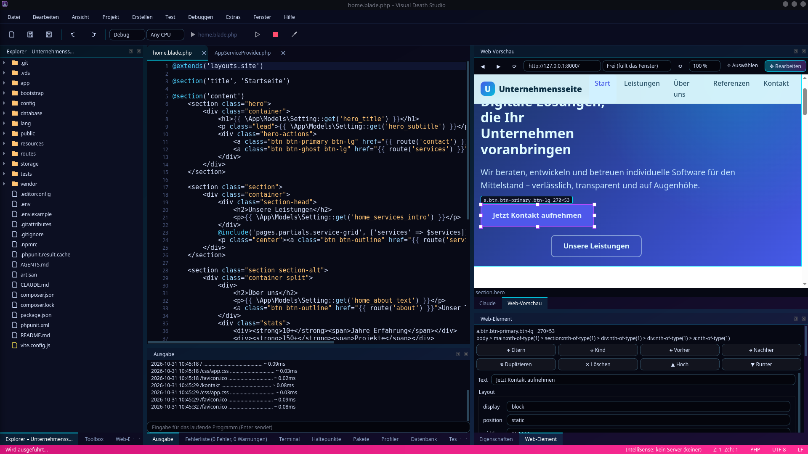
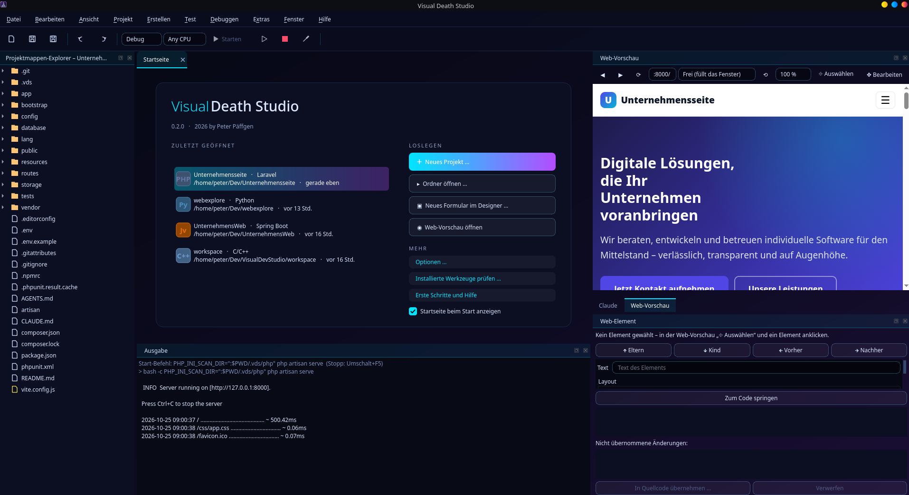
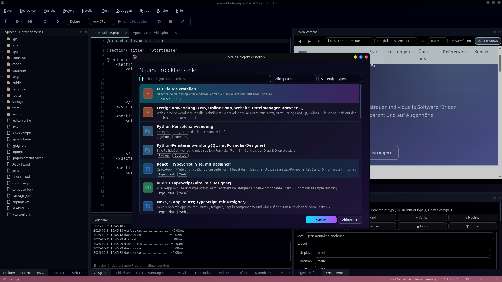

<div align="center">

# Visual Death Studio

**Native Qt-IDE mit Neon-Oberfläche – Webseiten, Formulare und Code visuell bauen.**

Inspiriert von Visual Studio, aber mit eigenem Design: Formular-Designer, visueller Web-Editor, Debugger, IntelliSense und Claude-Anbindung in einem Programm.

[](https://github.com/peter1965p/visual-death-studio/releases)


[](LICENSE)



</div>

---

## Inhalt

[Webseiten visuell bauen](#webseiten-visuell-bauen) · [Formulare visuell bauen](#formulare-visuell-bauen) · [Projekte](#projekte) · [Entwickeln](#entwickeln) · [Zusammenarbeit und Daten](#zusammenarbeit-und-daten) · [Claude](#claude) · [Tastenkürzel](#wichtige-tastenkürzel) · [Installation](#installation) · [Tests](#tests) · [Lizenz](#lizenz)

---

## Webseiten visuell bauen

Eine Laravel-, PHP-, React-, Vue-, Angular- oder reine HTML-Seite öffnen, in der **Web-Vorschau** anklicken, verschieben, ändern – und die Änderungen landen **sauber im Quellcode**. Mit **Strg+Alt+V** öffnet sich die eigene Ansicht *Visueller Web-Editor*: Bausteine und Struktur links, große Vorschau in der Mitte, Eigenschaften rechts.

| | |
|---|---|
| **Auswählen** (⌖) | Element anklicken: Details, Eltern/Kind/Geschwister, „Zum Code springen“ – auch aus Designer-Seiten (öffnet das Formular) |
| **Bearbeiten** (✥) | Verschieben, Größe per Griff, Pfeiltasten zum Feinjustieren (Umschalt = 10 px), Text per Doppelklick, Stile live im Inspektor (Farbe, Schrift, Abstand, Rahmen …) |
| **Bausteine** | Überschrift, Absatz, Button, Link, Bild, Abschnitt, zwei Spalten, Karte, Liste, Kontaktformular, Trennlinie – per Drag & Drop auf die Vorschau ziehen (grüne Linie zeigt *vor / in / nach* dem Element) oder per Doppelklick am gewählten Element einfügen |
| **Struktur** | Baum aller Elemente der Seite zum Auswählen; Duplizieren, Löschen, Hoch/Runter tauschen |
| **Speichern** | Knopf „💾 In Quellcode speichern (n)“ unter der Vorschau (oder Strg+Alt+S); „↶ Rückgängig“ nimmt die letzte Änderung zurück |

**Wie die Änderungen in den Quellcode kommen**

- Ein eigener **Parser für HTML, Blade, PHP, Vue und JSX** kennt die Elementstruktur der Dateien und ordnet jedes Element der Seite über Tag, Klassen, id, Attribute, Text und Eltern der richtigen Stelle zu. Mehrdeutige Treffer zeigt die IDE mit Unterschied zur Auswahl – geschrieben wird erst nach deiner Bestätigung.
- **Stile** gehen in die passende bestehende CSS-Regel, in Tailwind-Klassen, als Inline-Style oder als neue Regel – im Stylesheet, das die Seite wirklich lädt (z. B. `public/css/app.css` bei Laravel). Regeln, die **mehrere Elemente** treffen (z. B. `.btn-lg`), werden nur als letzte Wahl angeboten („gilt für n Elemente“).
- **Bausteine** nutzen die Klassen deines Projekts (`.btn`, `.card`, `.container`, Tailwind), sonst schlichte Inline-Stile.
- **Texte aus Laravel-Einstellungen** (`{{ Setting::get('schluessel') }}`): steht der Text nicht im Quelltext, bietet die IDE an, den Wert in der Datenbank zu ändern (mit Vorschau und Rückgängig). PHP startet dafür die Anwendung kurz im Projektordner.
- Offene Editor-Tabs werden vor dem Schreiben gesichert und danach nachgeladen; die Vorschau lädt von selbst neu.
- Grenzen: Elemente in Schleifen (`@foreach`) sind eine Vorlage für viele Einträge, Elemente ohne schließendes Tag werden nicht angefasst.

**Web-Vorschau für jedes Webprojekt** – alles mit Dev-Server und Browser-Adresse (Vite mit React oder Vue, Angular, Next, Nuxt, PHP, Laravel): eingebetteter Browser, der sich selbst öffnet, sobald der Server seine Adresse meldet; Geräte-Größen, Zoom, Konsolenfehler in der Fehlerliste. F5 startet den Server, Umschalt+F5 beendet ihn samt Kindprozessen.



---

## Formulare visuell bauen


- **Formular-Designer** mit Toolbox: 48 Steuerelemente in 7 Kategorien, Suche, A–Z-Liste; Dialoge wie Datei öffnen/speichern, Ordner, Farbe, Schrift, Drucken, Druckvorschau und MessageBox als Komponentenleiste; Eigenschaften, Farben, Schriften
- **Verschachtelung und Layouts:** Controls in GroupBox, Panel und TabWidget ziehen; Layouts (vertikal, horizontal, Raster) für Formular und Container
- **Mehrere Plattformen aus einem Formular:** **Python/Qt**, **Java Swing**, **React (TSX)**, **Vue 3** oder **Angular**; Layouts werden zu Flex/Grid-CSS bzw. Swing-Layout-Managern, Ereignisse zu Props/Emits bzw. überschreibbaren Java-Methoden

---

## Projekte



- **Neues Projekt** per Assistent, inklusive **„Mit Claude erstellen“**: Beschreibe das Projekt in eigenen Worten, Claude legt Struktur und Code an
- **Fertige Anwendungen** (Anwendung × Technik frei kombinieren): CMS, Online-Shop, Unternehmens-Website (mit Laravel, Spring Boot, React, Vue, Next, Nuxt oder Angular), Datenbank-App im Access-Stil, Dateimanager, Webbrowser (Qt bzw. Swing). Der Assistent legt das `.venv` an, installiert Pakete, prüft den Code (Python: Syntax und Importe; PHP: `php -l`; Laravel zusätzlich Datenbank-Einrichtung und Tests – SQLite wird bei Bedarf per Projekt-ini zugeschaltet, ohne die `php.ini` anzufassen; Swing: `javac`) und lässt Claude gefundene Fehler bis zu zweimal korrigieren
- **Projektvorlagen** mit Designer: React + TypeScript (Vite), Vue 3 (Vite), Angular, Next.js, Nuxt 3, Java Swing, **Spring Boot** (Maven-Wrapper, nur ein JDK nötig), **Laravel** (per `composer create-project`); dazu PHP (Skript und Webanwendung mit eingebautem Server)
- **Projekt importieren** (Strg+Alt+I): Qt Creator (`.pro` per qmake, CMake-Projekte), Visual Studio (`.sln`, `.csproj`, `.vcxproj` – C++ wird über eine abgeleitete CMake-Datei unter `.vds/import/` gebaut), Code::Blocks (`.cbp`), IntelliJ (`.iml`), Eclipse (`.project`, Java mit `javac`), Swift Package, Xcode (nur zum Bearbeiten), Maven, Gradle. Das Projekt bleibt an seinem Ort; die IDE trägt nur Build- und Startbefehl ein, eigene Einträge bleiben erhalten
- **Projekt exportieren** (Strg+Alt+X): Qt Creator (`CMakeLists.txt` bzw. `.pyproject`), Visual Studio (`.sln` bzw. CMake-Ordner), VS Code (`tasks.json`, `launch.json`), IntelliJ/PyCharm/CLion (`.idea`, `.iml`), Eclipse (`.project`, `.classpath`) oder ZIP ohne `venv`, `node_modules`, `build` u. a.; vorhandene Dateien werden nie überschrieben
- **Startseite** (Strg+Umschalt+H): zuletzt geöffnete Projekte mit erkanntem Typ (Laravel, Spring Boot, React, Vue, Angular, Python …) und Schnellaktionen
- **Start-Befehl pro Projekt** (z. B. `npm run dev`, `php -S …`) und weitere Einstellungen unter Projekt → Eigenschaften

---

## Entwickeln


- **Editor** mit Syntax-Hervorhebung, IntelliSense per LSP (pylsp, clangd) und optionaler Claude-Vervollständigung; sprachabhängige Codeausschnitte in der Toolbox (Python, Node, TypeScript, C, C++, C#, Rust, Go, Java, Bash)
- **Debugger** für Python, C/C++ (gdb), Node, Java, Go (dlv) und C# (netcoredbg): Haltepunkte, Variablen, Überwachung, Aufrufliste, Direktfenster
- **Erstellen** erkennt CMake, Make, Cargo, Go, .NET, Maven, Gradle und npm; eigene Build-/Clean-Befehle möglich
- **Test-Explorer** für pytest, unittest, node:test, Go, Cargo und dotnet
- **Refactorings:** Umbenennen, Verweise suchen, Formatieren, Quick Actions
- **Befehlspalette und globale Suche** (Strg+Q): Befehle, Dateien, Einstellungen und Textstellen mit unscharfer Suche; Präfixe `>` Befehle, `%` Text, `@` Einstellungen
- **Profiler** (Alt+F2): CPU-Zeit (cProfile) und Speicher (tracemalloc) für Python-Skripte, sortierbare Tabelle, Doppelklick springt zur Stelle im Code
- Diff-/Review-Ansicht, Paket-Manager, Terminal, Farbschemata **Neon** (dunkel) und **Hell**

---

## Zusammenarbeit und Daten

- **Git** im Änderungen-Fenster: Commit, **Push**, Pull und Remote eintragen. Push/Pull laufen im Hintergrund ohne Passwortabfrage – bei Anmeldeproblemen erklärt die IDE, wie SSH-Schlüssel oder `gh auth login` einzurichten sind
- **Live Share** (Strg+Alt+J): Projekt über einen Code teilen – der Gast erhält eine Kopie, Änderungen laufen live in beide Richtungen (optional nur lesen). Die Verbindung ist **unverschlüsselt**: nur im lokalen Netz oder per VPN nutzen; neue und gelöschte Dateien werden nicht übertragen
- **Datenbank-Explorer** (Strg+Alt+D): SQLite (auch per Doppelklick auf `.db`/`.sqlite`), MySQL/MariaDB, PostgreSQL, ODBC über Qt SQL (Client-Bibliotheken müssen installiert sein); Tabellen, Sichten, Spalten, SQL ausführen, Ergebnistabelle; Kennwörter werden nie gespeichert
- **Automatische Updates:** VDS sucht beim Start (höchstens einmal am Tag, abschaltbar unter Extras → Optionen → Allgemein) und über Hilfe → Nach Updates suchen nach neuen GitHub-Releases. Bei einem Git-Klon (so legt `install.sh` die Installation an) genügt ein Klick auf „Jetzt aktualisieren“: Vorspulen auf das Release-Tag, Pakete aktualisieren, Neustart. Lokale Änderungen oder eigene Commits im Programmordner werden nie überschrieben – dann zeigt VDS nur die Release-Seite

---

## Claude

Chat, Agent und Code-Vervollständigung wahlweise über die lokale **Claude-Code-CLI** oder mit **eigenem API-Schlüssel** (Extras → Optionen → Claude): Agent mit Dateiwerkzeugen im Projektordner, Modellwahl, Verbindungstest. Dein Code geht in beiden Fällen an Anthropic; der Schlüssel liegt in einer nur für dich lesbaren Datei im Konfigurationsordner, nie in den Optionen.

---

## Wichtige Tastenkürzel

Alle Kürzel zeigt **Hilfe → Tastenkürzel** (Strg+Alt+K).

| Bereich | Kürzel | Aktion |
|---|---|---|
| Projekt | Strg+Umschalt+N · Strg+Umschalt+O | Neues Projekt · Ordner öffnen |
| | Strg+Alt+I · Strg+Alt+X | Projekt importieren · exportieren |
| Suche | Strg+Q · Strg+P | Befehlspalette · Datei öffnen |
| | Strg+Umschalt+P · Strg+Umschalt+F | Befehle · Text in Dateien |
| Web | Strg+Alt+W · Strg+Alt+R | Vorschau öffnen · neu laden |
| | Strg+Alt+E · Strg+Alt+B | Element auswählen · visuell bearbeiten |
| | **Strg+Alt+V** · Strg+Alt+S | **Visueller Web-Editor** · Änderungen in den Quellcode |
| Ausführen | F5 · Strg+F5 · Umschalt+F5 | Starten · ohne Debugging · beenden |
| | Strg+Umschalt+B | Projekt erstellen |
| Debuggen | F9 · F10 · F11 | Haltepunkt · Prozedurschritt · Einzelschritt |
| Editor | F12 · F2 · Umschalt+F12 | Zu Definition · Umbenennen · Verweise |
| Werkzeuge | Alt+F2 · Strg+Alt+D · Strg+Alt+J | Profiler · Datenbank · Live Share |
| Sonstiges | Strg+, · Strg+Umschalt+H · F7 / Umschalt+F7 | Optionen · Startseite · Code / Designer |

---

## Installation

```bash
git clone https://github.com/peter1965p/visual-death-studio.git
cd visual-death-studio
./install.sh
```

Das Skript legt eine virtuelle Python-Umgebung an, installiert die Abhängigkeiten, erzeugt den Starter `visual-death-studio` (in `~/.local/bin`) und einen Eintrag im Anwendungsmenü. Es braucht **Python 3.10+** und keine Administratorrechte; am Ende zeigt es, welche optionalen Werkzeuge (Compiler, Debugger, Sprachserver) fehlen. `./install.sh --help` listet die Optionen.

- **Ohne Skript:** `python -m venv venv && venv/bin/pip install -r requirements.txt && venv/bin/python run.py`
- **Laravel:** im Assistenten „Laravel-Webanwendung“ wählen (oder `composer create-project laravel/laravel meine-app` und Ordner öffnen); F5 startet `php artisan serve`, die Vorschau öffnet sich selbst. Für SQLite braucht PHP die Erweiterung `pdo_sqlite` (Arch: `php-sqlite`)
- **Farbschema:** Extras → Optionen → Allgemein (Neon dunkel oder Hell, wirkt nach einem Neustart)
- **Startbild abschalten:** Extras → Optionen → Allgemein oder `--no-splash`
- **Entfernen:** `./uninstall.sh` löscht Starter, Menüeintrag und die angelegte Umgebung; mit `--purge` auch die Einstellungen. Projekte bleiben unberührt

Compiler, Debugger und Sprachserver (gcc, gdb, clangd, node, go, dlv, java, dotnet, …) werden nicht mitgeliefert; die jeweilige Funktion steht zur Verfügung, sobald das Werkzeug installiert ist. Die Claude-Funktionen brauchen entweder die lokale `claude`-CLI oder einen eigenen Anthropic-API-Schlüssel.

---

## Tests

```bash
venv/bin/pip install -r requirements-dev.txt
QT_QPA_PLATFORM=offscreen venv/bin/python -m pytest tests
```

---

## Lizenz

MIT, siehe [LICENSE](LICENSE).
