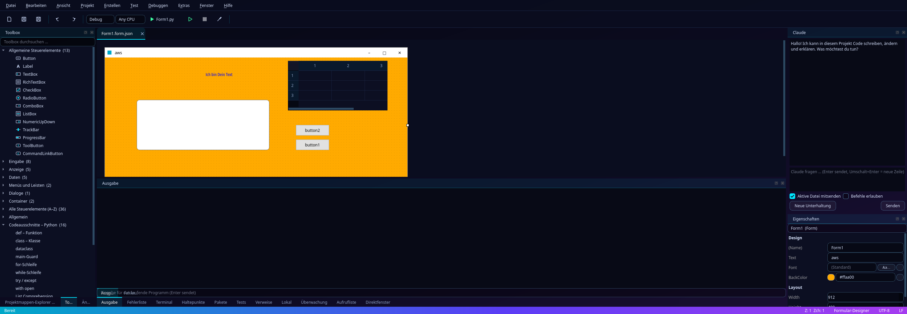
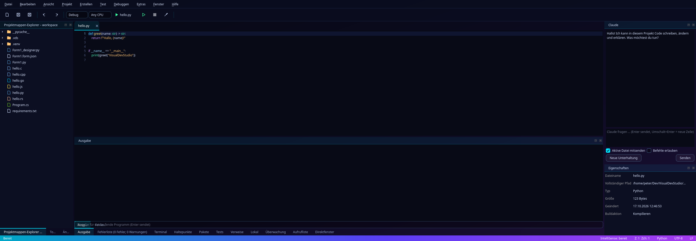

# Visual Death Studio

Native Qt-IDE (PySide6) mit Neon-Oberfläche, visuellem Formular-Designer, Debugger, IntelliSense und Claude-Anbindung.
Inspiriert von Visual Studio, aber mit eigenem Design.

## Funktionen

- **Formular-Designer** mit Toolbox (48 Steuerelemente in 7 Kategorien, Suche, A–Z-Liste; Dialoge wie Datei öffnen/speichern, Ordner, Farbe, Schrift, Drucken, Druckvorschau, MessageBox als Komponentenleiste), Eigenschaften, Farben und Schriften; erzeugt PySide6-Code
- **Verschachtelung und Layouts** im Designer: Controls in GroupBox, Panel und TabWidget ziehen, Layouts (vertikal, horizontal, Raster) für Formular und Container
- **Designer für mehrere Plattformen:** dasselbe Formular (Controls, Verschachtelung, Layouts) als **Python/Qt**, **Java Swing**, **React (TSX)**, **Vue 3** oder **Angular** ausgeben; Layouts werden zu Flex/Grid-CSS bzw. Swing-Layout-Managern, Ereignisse zu Props/Emits bzw. überschreibbaren Java-Methoden
- **Web-Vorschau für jedes Webprojekt** (Vite-Projekte mit React oder Vue, Angular, Next, Nuxt, PHP – alles, was einen Dev-Server mit Browser-Adresse hat): eingebetteter Browser, öffnet sich selbst, sobald ein Dev-Server seine Adresse meldet; Geräte-Größen, Zoom, Konsolenfehler in der Fehlerliste
  - **Elemente anklicken** (⌖): Details, Eltern/Kind-Navigation, „Zum Code springen“ (id, Klassen, Text werden im Projekt gesucht; Elemente aus Designer-Seiten öffnen direkt das Formular)
  - **Visuell bearbeiten** (✥): verschieben, Größe per Griff, Text per Doppelklick, Stile (Farbe, Schrift, Abstand, Rahmen …) live im Inspektor
  - **In den Quellcode übernehmen** (Strg+Alt+S): die IDE zeigt die Möglichkeiten mit Unterschied (bestehende CSS-Regel, Tailwind-Klassen, Inline-Style, neue Regel) – erst nach deiner Bestätigung wird geschrieben, mit „Rückgängig“
- **Projektvorlagen** mit Designer: React + TypeScript (Vite), Vue 3 (Vite), Angular, Next.js, Nuxt 3, Java Swing; dazu PHP (Skript und Webanwendung mit eingebautem Server)
- **Start-Befehl** pro Projekt (z. B. `npm run dev`, `php -S …`): F5 startet den Dev-Server, Umschalt+F5 beendet ihn samt Kindprozessen
- **Sprachabhängige Codeausschnitte** in der Toolbox (Python, Node, TypeScript, C, C++, C#, Rust, Go, Java, Bash)
- **Editor** mit Syntax-Hervorhebung, IntelliSense per LSP (pylsp, clangd) und optionaler Claude-Vervollständigung
- **Debugger** für Python, C/C++ (gdb), Node, Java, Go (dlv) und C# (netcoredbg) mit Haltepunkten, Variablen, Überwachung, Aufrufliste und Direktfenster
- **Test-Explorer** für pytest, unittest, node:test, Go, Cargo und dotnet
- **Refactorings**: Umbenennen, Verweise suchen, Formatieren, Quick Actions
- **Erstellen** erkennt CMake, Make, Cargo, Go, .NET, Maven, Gradle und npm; eigene Build-/Clean-Befehle und weitere Einstellungen unter Projekt → Eigenschaften
- **Projekt-Assistent** inklusive „Mit Claude erstellen“
- **Claude-Chat und -Vervollständigung** wahlweise über die lokale Claude-Code-CLI **oder mit eigenem API-Schlüssel** (Extras → Optionen → Claude; Agent mit Dateiwerkzeugen im Projektordner, Modellwahl, Verbindungstest)
- **Optionen** (Strg+,): Editor (Tab-Breite, Zeilenumbruch, Leerraum, Autospeichern), IntelliSense, Designer-Raster, Claude-Anbieter, Export/Import
- Diff-/Review-Ansicht, Git-Änderungen, Paket-Manager, Terminal

## Installation

    git clone https://github.com/peter1965p/visual-death-studio.git
    cd visual-death-studio
    ./install.sh

Das Skript legt eine virtuelle Python-Umgebung an, installiert die Abhängigkeiten, erzeugt den Starter `visual-death-studio`
(in `~/.local/bin`) und einen Eintrag im Anwendungsmenü. Es braucht Python 3.10+ und keine Administratorrechte; am Ende zeigt es,
welche optionalen Werkzeuge (Compiler, Debugger, Sprachserver) fehlen. `./install.sh --help` listet die Optionen.

Entfernen: `./uninstall.sh` (löscht Starter, Menüeintrag und die vom Skript angelegte Umgebung; mit `--purge` auch die Einstellungen,
Projekte bleiben unberührt).

Ohne Skript: `python -m venv venv && venv/bin/pip install -r requirements.txt && venv/bin/python run.py`.

Compiler, Debugger und Sprachserver (gcc, gdb, clangd, node, go, dlv, java, dotnet, …) werden nicht mitgeliefert; die
jeweilige Funktion ist verfügbar, sobald das Werkzeug installiert ist. Die Claude-Funktionen brauchen entweder die lokale
`claude`-CLI oder einen eigenen Anthropic-API-Schlüssel (Datenschutz: Dein Code geht in beiden Fällen an Anthropic; der Schlüssel liegt in einer
nur für dich lesbaren Datei im Konfigurationsordner, nie in den Optionen).

## Tests

    venv/bin/pip install -r requirements-dev.txt
    QT_QPA_PLATFORM=offscreen venv/bin/python -m pytest tests

## Lizenz

MIT, siehe [LICENSE](LICENSE).
